<a href="https://deepaksharma0801.github.io/Sai-Portfolio/">
  <picture>
    <source media="(prefers-color-scheme: dark)" srcset="./model-card-dark.svg">
    
  </picture>
</a>

### hey, i'm deepak 👋

I build AI agents that do real work, not demo work. Currently an **Associate AI Developer at [Echelix](https://echelix.com/)**, teaching LLMs to survive messy data, weird edge cases, and actual users.

> If a model can't explain itself to a stakeholder or survive messy input, it's still a prototype wearing a nice jacket.

**[portfolio](https://deepaksharma0801.github.io/Sai-Portfolio/)** · **[linkedin](https://www.linkedin.com/in/sai-deepak-sharma-09518b210/)** · **[email](mailto:saideepaksharma8@gmail.com)**

this README has a 0% hallucination rate. the projects below are real, pinned, and mildly over-engineered.
